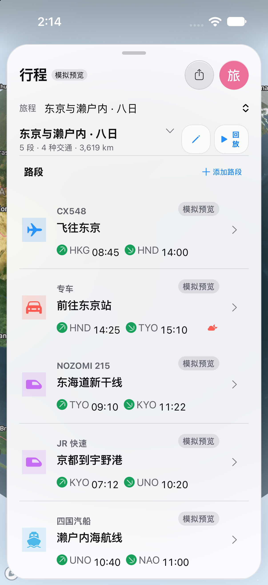
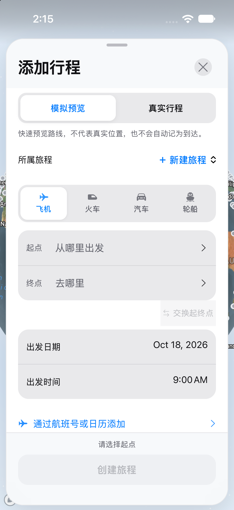

# fly everything · 多交通旅行规划

飞机、火车、汽车和轮船行程，在一张地图上规划与预览。React / TypeScript + Capacitor 混合应用，包含 iOS UIKit 控件、安全区、返回手势和前台定位桥接；不是 SwiftUI 全量实现。


<!-- browser-demos:start -->
## 最新动态演示：飞行 · 全球机场 · 行程统计

以下是**真实 Chrome 浏览器录制的 GIF，不是 iOS 录屏**。使用独立配置和明确标识的虚构演示数据；不访问或覆盖用户已有行程。

| 飞机飞行与地图跟随 | 全球机场浏览与定位 |
| --- | --- |
|  |  |
| 行程统计与年份筛选 | 飞机 / 火车 / 汽车 / 轮船行程切换 |
|  |  |

新增 **3 组、8 段**演示记录，覆盖 **4 种交通方式、10 个地点、7,160 km、25 小时**，可展示 2025 / 2026 年份筛选。**仅新存储首次启动显示，已有行程不会自动插入样例。**

[逐段说明、演示路线与复现方法](docs/demos/README.md) · [录制来源与 SHA-256](docs/demos/manifest.json)

最新演示代码位于 `build/ios-ui-20261018` 分支：[wkun475-star 仓库](https://github.com/wkun475-star/flighty-everything/tree/build/ios-ui-20261018) / [WanKun824 仓库](https://github.com/WanKun824/flighty-everything/tree/build/ios-ui-20261018)。默认分支只同步图册/Markdown，不覆盖其业务代码；此前发布的 IPA 不含这次新增样例。
<!-- browser-demos:end -->

**本轮预览交付：2026-10-18，版本 0.3.2。** 当前源码与文档位于 `build/ios-ui-20261018` 分支。保留私有仓库权限，不自动部署旧在线演示。历史版本的安装包、截图与当时问题单独归档，不混作当前结果。

## 下载与交付内容

**[本轮 GitHub Release：源码、文档/截图、Web 包和 IPA](https://github.com/wkun475-star/flighty-everything/releases/tag/delivery-2026-10-18-ui)**

| 文件 | 用途 | 注意 |
| --- | --- | --- |
| `flighty-everything-0.3.2-source-*.zip` | 完整源码、iOS/Android 工程、依赖锁、模型、目录、测试、文档和截图 | 不含 Git 历史、依赖目录、缓存、用户数据或签名材料；内置文件哈希清单 |
| `flighty-everything-docs-screenshots.zip` | 独立阅读文档和各页面图片 | 区分本轮 iOS、网页验证及历史截图 |
| `flighty-everything-web-*.tar.gz` | Web 生产构建和 Capacitor Web 资源 | 用于产物检查；Worker/D1 部署请用完整源码，不是 IPA/APK |
| `flighty-everything-ios-arm64-unsigned.ipa` | Xcode 生成的 iPhone 设备包 | **未签名，需自行签名后安装**；不是 TestFlight / App Store 包 |
| `flighty-everything-browser-report.zip` | Chrome 浅色/深色/小屏交互报告和网页截图 | 离线网页证据，不是 iOS 截图 |
| `SHA256SUMS.txt`、验证报告 | 核对下载资产、内部源码和来源 | 文件完整性检查不是代码签名或安全认证 |

私有仓库下载需要相应 GitHub 权限。GitHub 自动生成的 Source code ZIP 不含自定义哈希清单；建议下载上表的验证源码包。GitHub 仓库页面本身不能运行 IPA。

## 当前页面截图与验证

- **[本轮 iPhone 17 Pro 模拟器逐页图册](docs/runtime-20261018/README.md)**：32 个页面/状态，共 **62 张原图（深色 32、浅色 30）**；浅色最小行程与中档社区两项未完成，已明确记录。每页附结果、PNG、SHA-256、标题、源码和运行记录。
- [视觉检查与覆盖限制](docs/runtime-20261018/VISUAL_NOTES.md)：截图生成不等于 UI/功能全部通过。
- [网页浅色 / 深色 / 小屏验证与拼版](docs/runtime-ui-ux-web/VISUAL_NOTES.md)：明确标为网页离线测试，不能冒充 iOS 原生截图。
- [机器可读交付验证](PACKAGE-VERIFICATION.json)：本轮测试、构建与截图来源；最终下载包的 SHA-256 见 Release。

图册通过仅限模拟器且显式开启的助手进入**现有应用页面**，然后由 `simctl` 截取真实像素。没有生成替代 UI，也不使用历史图补缺。页面导航助手不是手指触摸测试；未完成状态会明确记录。

| 行程列表 | 添加行程 |
| --- | --- |
|  |  |

图册还包括路段详情、真实时刻编辑、地点选择、航班工具、机场目录/搜索/详情、天气图层、同行、个人资料、旅迹与主应用社区。使用全新模拟器演示数据，不确认删除、不请求定位、不发送邀请或发布社区。

## 快速运行

需要 Node.js >=22.13.0（推荐 Node 22）、npm、Git 和网络。Windows 可用 `npm.cmd`。

```sh
git clone --branch build/ios-ui-20261018 https://github.com/wkun475-star/flighty-everything.git
cd flighty-everything
npm ci
npm run dev
```

从源码 ZIP 重建时，先按完整指南在独立目录初始化本地 Git 快照，因为原生资源会记录当前 Git 提交。

```sh
npm test                                  # 生产构建 + 自动测试
npx tsc --noEmit -p tsconfig.json
npm run native:build                     # 只构建内嵌 Web 资源
npx playwright test                      # 本机 Chrome，含 32 页目标回归
npm run lint                             # 存在已知失败，不能伪报通过
```

## 文档导航

- [开发、环境配置、各端构建与 GitHub 操作](docs/开发与打包说明.md)
- [交付清单、数据边界和已知限制](docs/交付清单与已知限制.md)
- [当前代码与分系统文档导航](docs/README.md)
- [UI/UX 方案及执行进度](docs/UI-UX-改进计划.md)
- [iOS 原始截图采集与验证工具](ios/qa/README.md)
- [素材授权待核对事项](MODEL_LICENSES.md)

GitHub 工作流分别处理：`Package Web Build`（构建/测试/源码与文档包）、`Package iOS Client`（设备 IPA）、`Capture iOS Pages on Xcode`（浅/深原生截图）。它们记录精确源码，不能把一个任务成功推断为其他任务也已通过。

## 真实边界

- 主要界面改为统一中文、四项底栏、单层面板、统一标题、地图控件避让、分组表单、删除确认/撤销及中性旅迹卡片；旧 CSS / 字号 / 调色板仍未彻底收敛。
- 原生图册仍发现浅色最小旅迹数字对比度、编辑留白、旧引导样式/文案和状态栏问题，见视觉备注；**UI 方案未全部验收通过**。
- Lint 仍有 **9 errors / 9 warnings**，依赖安全及大 chunk 也有待处理；详见交付清单。构建成功不代表全部代码质量门槛已通过。
- 同行目前是本地演示；原生社区与 Web D1 社区不等同于完成真实同步。
- 地图、天气、航班和列车查询依赖第三方网络、token 和区域覆盖；基础机场目录与示例统计不是实时运营通告。
- 本机行程、资料和草稿不提供自动跨设备备份；卸载、清除或系统清理可能丢失。
- 未完成实体 iPhone / Android、全部 Dynamic Type / VoiceOver、后台定位和完整业务提交验收。模拟器截图也不能代替这些检查。

历史：[2026-09-23 模拟器图册](docs/runtime-20260923/README.md)、[旧截图档案](docs/screenshots/README.md)、[旧交付清单](docs/delivery/README.md)。已有在线演示本轮未部署，不保证与 Release 一致。
