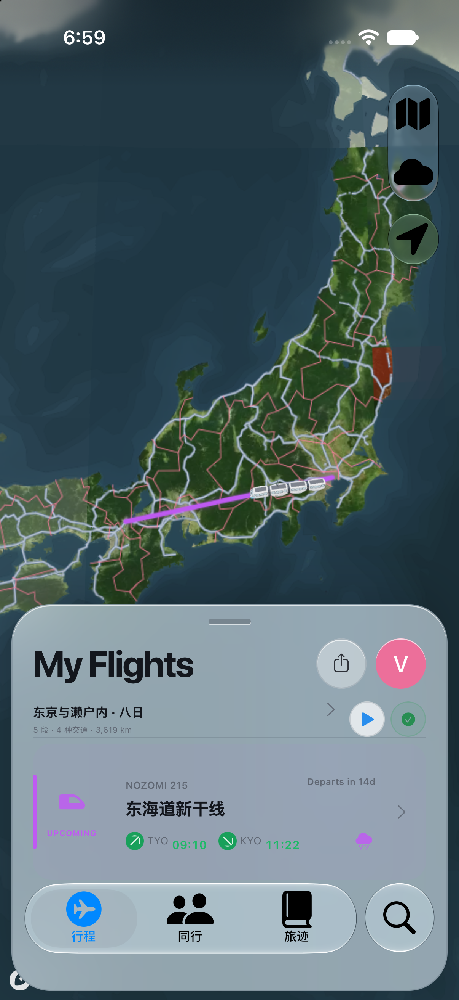

# fly everything

多交通方式旅行规划与地图应用：飞机、火车、汽车、轮船，以及行程、旅记、机场收藏、模拟预览和前台真实定位。


**交付日期：2026-09-21。** 最新应用源码为 `51173f1d5efa2037354d2dd056cdc3d343f50c10`。本次在此基础上补充文档、已有截图和文件清单，没有重新构建或测试应用。

## 下载与文档

- [下载源码 ZIP 与现有 IPA](https://github.com/wkun475-star/flighty-everything/releases/tag/delivery-2026-09-21)
- [实际运行截图：每张图的说明、版本与异常记录](docs/screenshots/README.md)
- [开发、运行和 GitHub 打包说明](docs/GETTING_STARTED.md)
- [交付清单与已知限制](docs/delivery/README.md)
- [图标设计与提示词](docs/fly-brand.md)

最新版安装包：`fly-everything-20260920-51173f1-unsigned.ipa`，名称 `fly everything`，版本 `0.3.2` / build `5`。**未签名，需要自行签名后安装**；不是可直接安装的 App Store / TestFlight 包。

## 实际运行截图

以下是已有 iOS 模拟器运行记录，**不是设计图，不是最新 51173f1 的截图，也不是实体手机拍摄**。本次使用原有文件，保留旧布局及渲染异常。

| 浅色火车行程（e026fa5） | 深色汽车行程（f739989） |
| --- | --- |
|  |  |
| [图 1：逐项说明与限制](docs/screenshots/01-train-light.md) | [图 2：逐项说明与限制](docs/screenshots/02-car-dark.md) |

另外收录 [图 3：地图未显示的浅色航班页](docs/screenshots/03-flight-light.md) 和 [图 4：系统桌面误截图](docs/screenshots/04-system-home.md)。没有最新版添加行程、旅记或机场页的可确认截图，不使用用户提供的设计参考图替代。

## 本地运行

```sh
npm ci
npm run dev
```

需要 Node.js >= 22.13.0（建议 Node 22）及网络。Windows 可用 `npm.cmd`。地址以终端输出为准；配置见 [运行文档](docs/GETTING_STARTED.md)。

这是 React / TypeScript + Capacitor 混合应用。iOS 内嵌前端资源，并提供 UIKit 玻璃控件、手势和前台 Core Location 桥接；不是全 SwiftUI 应用，也不是只打开在线网址的快捷方式。

## GitHub 上如何使用

仓库用于查看源码、文档和截图，Release 用于下载；**GitHub 页面本身不能运行 iPhone IPA**。现有 Actions 工作流可在适用的 Apple Silicon / Xcode runner 上编译 iOS。

[最新 IPA 成功打包记录](https://github.com/wkun475-star/flighty-everything/actions/runs/35517541715) 对应 `51173f1`，当时 `skip_tests=true`。构建成功不代表真机验收通过。

已有 [在线演示](https://manyou-travel-ui-demo.zvcdg28tfj.chatgpt.site/) 本次未部署，不能保证与 Release 版本相同。仓库沿用现有私有权限。

## 功能边界

- 地图、天气、航班和列车查询依赖外部服务与地区覆盖；机场目录不等于实时运营状态。
- 真实模式使用用户输入的出发/到达时间、时区和前台授权定位，不保证后台持续定位。
- 行程主要保存在本机，不是跨设备云备份；清除数据可能丢失记录。
- 模型和第三方素材的再分发许可需另行核对，见 `MODEL_LICENSES.md`。
- 旧 `HANDOFF*.md`、旧日期报告只作历史参考。本次交付状态以 `docs/delivery/README.md` 为准。
