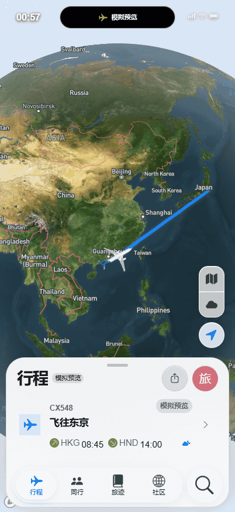
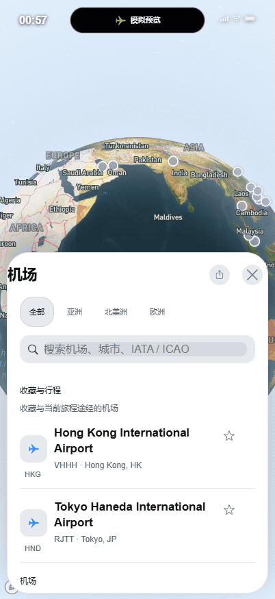
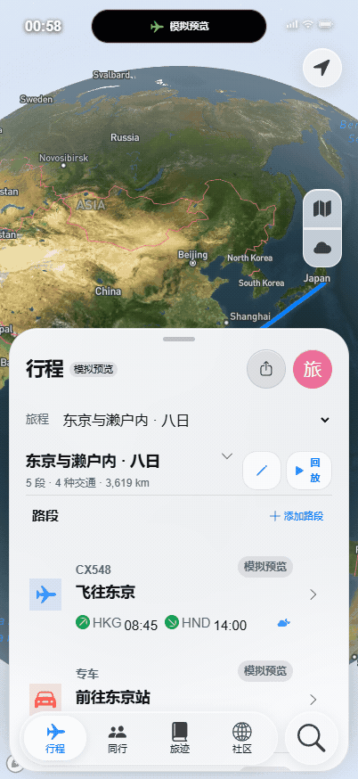

# 浏览器动态演示：飞行、机场、统计与多交通行程

这些 GIF 来自实际运行的 Chrome 浏览器，不是 iOS 模拟器、真机录屏或生成式设计图。视口为 402 × 874，独立临时浏览器配置，不读取日常浏览器数据。画面中的系统状态栏是 Web 应用自身界面，不能当作 UIKit 验收。

应用来源、录制时间、原始截图帧数、尺寸、SHA-256 和录制前后状态见 [manifest.json](manifest.json)。原始 PNG 帧保留在本机 `build/gif-capture/`；GIF 只做调色板压缩和按真实时间间隔采样，没有重绘地图或伪造 UI。地图使用真实 Mapbox 底图，机场使用项目的 OurAirports 基础目录；不证明航班或机场实时运营状态正确。

## 1. 飞机飞行



香港 → 东京的模拟飞行。飞机处于跟随模式，机体保持屏幕中心，底图随飞机位置移动，并由起飞阶段过渡到巡航。不是 ADS-B 实时位置，也不是按真实飞行时长播放。

## 2. 全球机场浏览



打开机场列表，切换欧洲/北美洲，搜索 LHR / JFK，查看伦敦希思罗和纽约肯尼迪机场的基础资料与地图定位。地图上的点有缩放与展示筛选，不代表每个机场在每一级缩放都显示。

## 3. 行程统计


展示完整旅迹、2025 年筛选、月份频率、旅行距离、在途时间和常用载具。图中的 **3 组、8 段、7,160 km、25 小时、4 种交通方式、10 个地点** 均来自下表的虚构演示数据，不是实际个人出行记录。历史日期只是为了展示年份筛选。

## 4. 多交通行程切换



从原有东京旅程切换到日本山海联程，再选择火车、汽车和轮船路段，最后切换到亚洲航空行程。未发布社区内容、请求定位或操作他人数据。

## 新增的三组行程

| 行程 | 路段 | 模式 | 示例日期 | 距离 | 时长 |
| --- | --- | --- | --- | ---: | ---: |
| 【演示】亚洲城市跳跃 | 香港 → 新加坡 → 曼谷 → 香港 | 飞机 × 3 | 2026-06-01 / 03 / 05 | 5,670 km | 9 小时 15 分 |
| 【演示】日本山海联程 | 东京 → 京都 → 神户 → 高松 | 火车、汽车、轮船 | 2026-04-08 / 09 / 11 | 681 km | 8 小时 25 分 |
| 【演示】2025 欧洲城际 | 伦敦 → 巴黎 → 里昂 | 火车、汽车 | 2025-10-03 / 05 | 809 km | 7 小时 20 分 |

源码为 `app/demoJourneys.ts`。全部样例明确标为“演示 / 手工记录 / 非真实出行”，没有真实车次、票务或运营时刻承诺；距离和时间用于界面展示，铁路/公路线路也不冒充已核验的实际道路。

### 数据保护与版本

- 演示分支：[`wkun475-star`](https://github.com/wkun475-star/flighty-everything/tree/build/ios-ui-20261018) / [`WanKun824`](https://github.com/WanKun824/flighty-everything/tree/build/ios-ui-20261018)。请检出该分支体验最新界面与样例；默认分支仅同步此图册和 Markdown，不覆盖其业务代码。
- 全新存储首次启动时，原有两组旅程加上这三组演示行程，共五组。已有 `journey:v2` / v1 数据原样加载，不自动插入样例，更不会覆盖、删除或把用户行程标记完成。
- 若本机已有数据，请用独立浏览器配置/新环境体验样例。不要为了查看演示而清除自己的行程。
- 之前发布的 IPA / Web 包仍保留原提交 `cc28081`；本次只更新演示源码和文档，没有重新生成 IPA，也不能把新样例说成已进入旧安装包。
- 静态 iOS 图册和已知 UI / lint 问题仍按原记录解释，GIF 不代替设备、辅助功能或全部业务验收。

## 复现录制

先检出上述演示源码分支，再准备 Node 22.13+、npm、Chrome 和 PATH 中的 FFmpeg（本轮 FFmpeg 8.0.1）。两个终端分别运行：

```sh
npm ci
npm run dev -- --port 3007 --hostname 127.0.0.1
```

```sh
node scripts/record-demo-gifs.mjs
```

可用 `DEMO_BASE_URL`、`PLAYWRIGHT_CHROME_PATH`、`FFMPEG_PATH` 调整本机路径。录制器只使用隔离存储、已有控件和显式开启的 QA 导航助手；不改变行程业务逻辑。联网地图/模型准备失败会报错，不用假地图替代。

本轮演示源码分支的验证（不是旧默认分支的质量报告）：[verification.json](verification.json)。**Node 自动测试 162/162、浏览器 42/42 通过**；TypeScript 与原生 Web 构建通过。新增用例检查数据 ID、连续性、四种载具、年份、统计、非实时标识、首次初始化和已有存储保护。四段 GIF 的哈希、动画帧数、循环标记和尺寸已检查。`npm run lint` 仍有 9 errors / 9 warnings，未禁用规则或宣称全部质量门槛通过。
