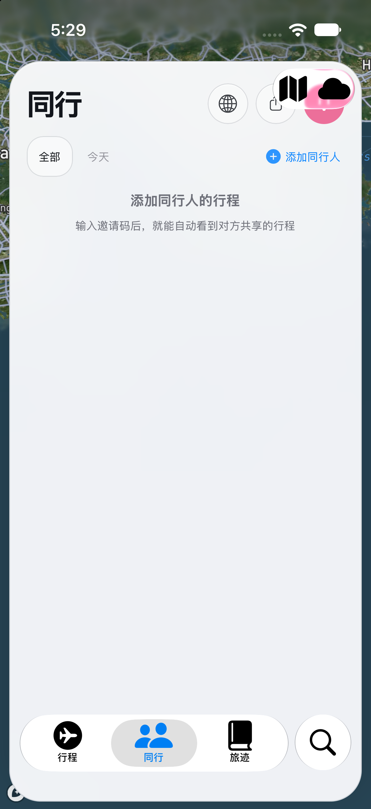

# 同行列表

同行列表或当前空状态，不创建外部关系。

请同时阅读 [可见问题与覆盖限制](VISUAL_NOTES.md)。截图生成成功不等于功能或布局验收通过。

源码：`1d988b8fe3cda4d30a357b97e128f489afadf930`。[本次运行](https://github.com/wkun475-star/flighty-everything/actions/runs/35631024628)。

## 浅色

- 文件：`22-friends-list-light.png`。
- 内容说明：同行列表或当前空状态，不创建外部关系。
- 页面实际标题：同行。
- 目标元素：`.primary-panel[data-tab="friends"]`。
- 模拟器设置外观：`light`；页面主题字段：`未提供，不能据此验证实际配色`；视口：`{'width': 402, 'height': 874, 'scale': 1}`。
- 地图就绪字段：`true`；该字段不保证地图瓦片无缺失。
- 原图 SHA-256：`9a35024f8f5df0a0c65b50455cd55e1c229c48a6c7f261f3d2ea11f263f95af4`。

截图仅记录此时此刻的可见页面。外部数据、定位、输入键盘、滑动手势和业务提交并未因此被验证。可见异常应结合本册的人工检查备注理解。
