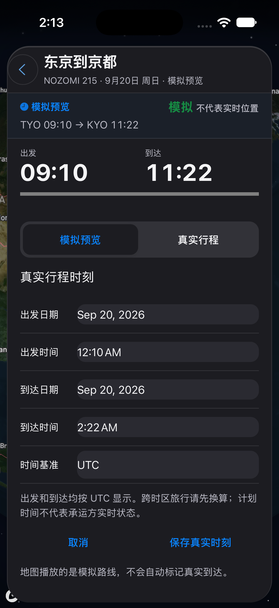
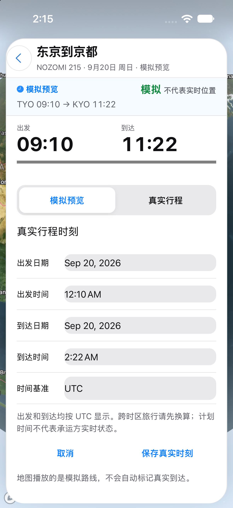

# 路段详情：真实时刻编辑

真实时刻编辑，不保存计划或请求定位。

请同时阅读 [可见问题与覆盖限制](VISUAL_NOTES.md)。截图生成成功不等于功能或布局验收通过。

初次批次源码：`db626c81118473c8233c026bbe6503ccba3c92d9`。[初次运行](https://github.com/wkun475-star/flighty-everything/actions/runs/39134486762)；各图真实来源见下方。

## 深色

- 本图源码：`db626c81118473c8233c026bbe6503ccba3c92d9`；[本图采集运行](https://github.com/wkun475-star/flighty-everything/actions/runs/39134486762)。
- 文件：`04b-real-time-editor-dark.png`。
- 内容说明：真实时刻编辑，不保存计划或请求定位。
- 页面实际标题：东京到京都 / 真实行程时刻。
- 目标元素：`.real-plan-editor`。
- 模拟器设置外观：`dark`；页面主题字段：`dark`；视口：`{'width': 402, 'height': 874, 'scale': 1}`。
- 地图就绪字段：`true`；该字段不保证地图瓦片无缺失。
- 原图 SHA-256：`21fec6c7ebcb5b070b0cb69016c3dd1b7dd0d5be4752359d38c1f8df27971b39`。
- 补采记录：无；初次成功采集。

截图仅记录此时此刻的可见页面。外部数据、定位、输入键盘、滑动手势和业务提交并未因此被验证。可见异常应结合本册的人工检查备注理解。

## 浅色

- 本图源码：`db626c81118473c8233c026bbe6503ccba3c92d9`；[本图采集运行](https://github.com/wkun475-star/flighty-everything/actions/runs/39134486762)。
- 文件：`04b-real-time-editor-light.png`。
- 内容说明：真实时刻编辑，不保存计划或请求定位。
- 页面实际标题：东京到京都 / 真实行程时刻。
- 目标元素：`.real-plan-editor`。
- 模拟器设置外观：`light`；页面主题字段：`light`；视口：`{'width': 402, 'height': 874, 'scale': 1}`。
- 地图就绪字段：`true`；该字段不保证地图瓦片无缺失。
- 原图 SHA-256：`b49cb978e62d69cb97e7b1c9b62bcaa133ddd24ac1886be0ac61b75571f769a4`。
- 补采记录：无；初次成功采集。

截图仅记录此时此刻的可见页面。外部数据、定位、输入键盘、滑动手势和业务提交并未因此被验证。可见异常应结合本册的人工检查备注理解。
