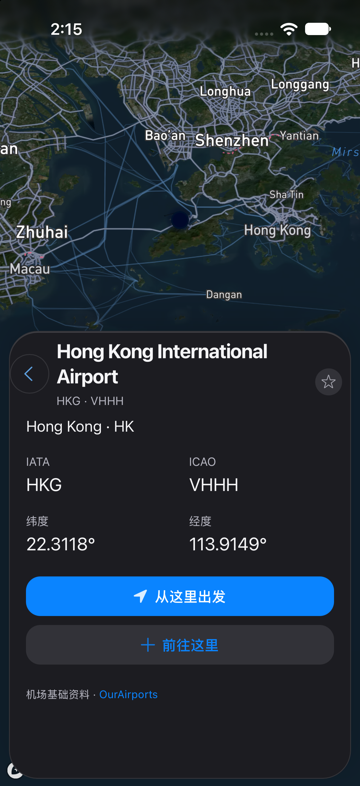
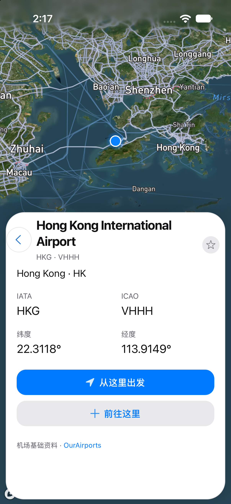

# 机场：香港机场资料

实际 HKG 基础资料，不伪造登机口、航班或运营状态。

请同时阅读 [可见问题与覆盖限制](VISUAL_NOTES.md)。截图生成成功不等于功能或布局验收通过。

初次批次源码：`db626c81118473c8233c026bbe6503ccba3c92d9`。[初次运行](https://github.com/wkun475-star/flighty-everything/actions/runs/39134486762)；各图真实来源见下方。

## 深色

- 本图源码：`db626c81118473c8233c026bbe6503ccba3c92d9`；[本图采集运行](https://github.com/wkun475-star/flighty-everything/actions/runs/39134486762)。
- 文件：`16-airport-detail-dark.png`。
- 内容说明：实际 HKG 基础资料，不伪造登机口、航班或运营状态。
- 页面实际标题：Hong Kong International Airport。
- 目标元素：`.airport-detail-sheet`。
- 模拟器设置外观：`dark`；页面主题字段：`dark`；视口：`{'width': 402, 'height': 874, 'scale': 1}`。
- 地图就绪字段：`true`；该字段不保证地图瓦片无缺失。
- 原图 SHA-256：`d6349d503b63b6d2c2abd3e98f13482d81ad614d601cab79da5666d195eefd20`。
- 补采记录：无；初次成功采集。

截图仅记录此时此刻的可见页面。外部数据、定位、输入键盘、滑动手势和业务提交并未因此被验证。可见异常应结合本册的人工检查备注理解。

## 浅色

- 本图源码：`db626c81118473c8233c026bbe6503ccba3c92d9`；[本图采集运行](https://github.com/wkun475-star/flighty-everything/actions/runs/39134486762)。
- 文件：`16-airport-detail-light.png`。
- 内容说明：实际 HKG 基础资料，不伪造登机口、航班或运营状态。
- 页面实际标题：Hong Kong International Airport。
- 目标元素：`.airport-detail-sheet`。
- 模拟器设置外观：`light`；页面主题字段：`light`；视口：`{'width': 402, 'height': 874, 'scale': 1}`。
- 地图就绪字段：`true`；该字段不保证地图瓦片无缺失。
- 原图 SHA-256：`c21626848055c1f0724ad1722da66d702ba0493a49b6bb10f95c1a419c87e5ad`。
- 补采记录：无；初次成功采集。

截图仅记录此时此刻的可见页面。外部数据、定位、输入键盘、滑动手势和业务提交并未因此被验证。可见异常应结合本册的人工检查备注理解。
