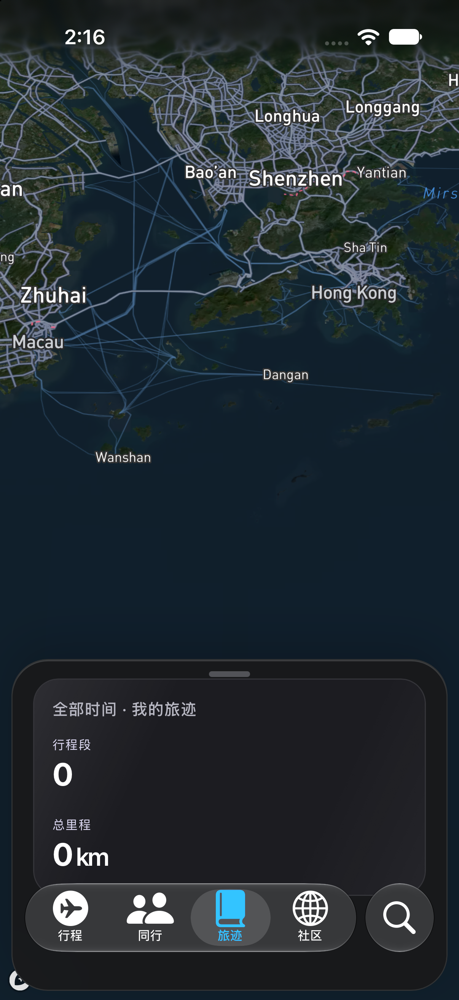
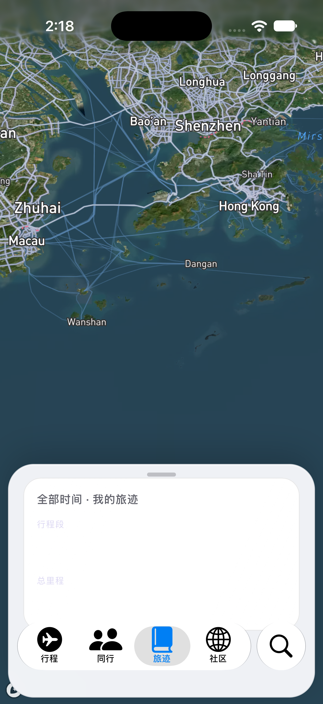

# 旅迹：最小面板

最小旅迹摘要；演示行程不代表真实足迹。

请同时阅读 [可见问题与覆盖限制](VISUAL_NOTES.md)。截图生成成功不等于功能或布局验收通过。

初次批次源码：`db626c81118473c8233c026bbe6503ccba3c92d9`。[初次运行](https://github.com/wkun475-star/flighty-everything/actions/runs/39134486762)；各图真实来源见下方。

## 深色

- 本图源码：`db626c81118473c8233c026bbe6503ccba3c92d9`；[本图采集运行](https://github.com/wkun475-star/flighty-everything/actions/runs/39134486762)。
- 文件：`25-passport-compact-dark.png`。
- 内容说明：最小旅迹摘要；演示行程不代表真实足迹。
- 页面实际标题：此状态没有独立文字标题。
- 目标元素：`.primary-panel[data-tab="passport"]`。
- 模拟器设置外观：`dark`；页面主题字段：`dark`；视口：`{'width': 402, 'height': 874, 'scale': 1}`。
- 地图就绪字段：`true`；该字段不保证地图瓦片无缺失。
- 原图 SHA-256：`09cb0dc9010f9519f15b14e389abb469aedc36fc55559b862dfdf0a988b714ad`。
- 补采记录：无；初次成功采集。

截图仅记录此时此刻的可见页面。外部数据、定位、输入键盘、滑动手势和业务提交并未因此被验证。可见异常应结合本册的人工检查备注理解。

## 浅色

- 本图源码：`db626c81118473c8233c026bbe6503ccba3c92d9`；[本图采集运行](https://github.com/wkun475-star/flighty-everything/actions/runs/39134486762)。
- 文件：`25-passport-compact-light.png`。
- 内容说明：最小旅迹摘要；演示行程不代表真实足迹。
- 页面实际标题：此状态没有独立文字标题。
- 目标元素：`.primary-panel[data-tab="passport"]`。
- 模拟器设置外观：`light`；页面主题字段：`light`；视口：`{'width': 402, 'height': 874, 'scale': 1}`。
- 地图就绪字段：`true`；该字段不保证地图瓦片无缺失。
- 原图 SHA-256：`9e1684f109d41ffa49f508436e76c5a5c3615b4e04ba2892ac22d0335f8ab2f4`。
- 补采记录：无；初次成功采集。

截图仅记录此时此刻的可见页面。外部数据、定位、输入键盘、滑动手势和业务提交并未因此被验证。可见异常应结合本册的人工检查备注理解。
