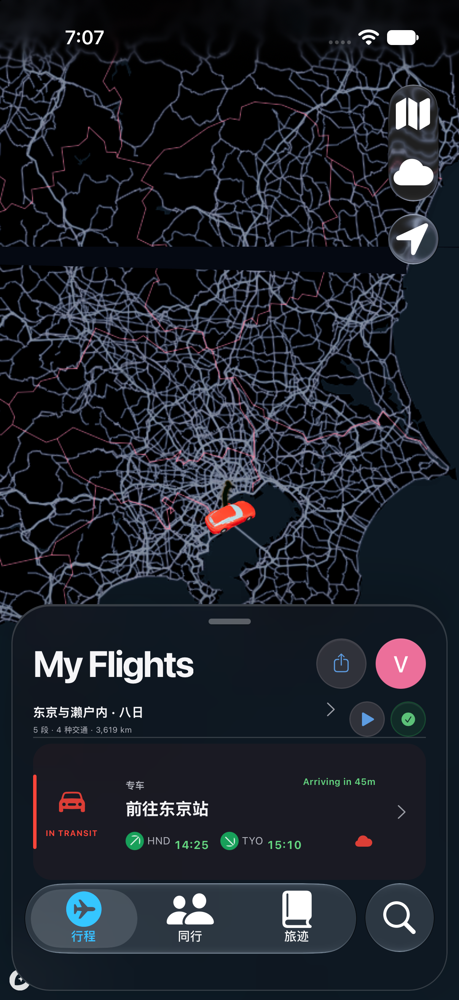

# 图 2：深色汽车行程与地图

## 来源

原文件为 `release/run26-f739989/qa/iphone-dark.png`，目录版本 `f739989`，1206 × 2622 像素。iOS 模拟器实际运行截图，不是最新 `51173f1`。关联 [布局记录](evidence/f739989-layout-audit.json)。

## 元素与用途

深色地图中有红色汽车模型；右侧为白色图形的地图、天气和跟随按钮。底部深色面板显示旅程摘要、分享、头像和 Dock。

汽车路段为“前往东京站”，状态 `IN TRANSIT`，显示 HND → TYO、14:25 → 15:10 和 `Arriving in 45m`。红色图标、侧边色条用于区分汽车。

## 可确认和限制

能确认历史深色外观与汽车路段同时呈现。不能证明真实道路导航、实际车辆位置、倒计时准确性或交互流畅度。地图上方有明显黑色横条/瓦片异常，保留原样；这不是无缺陷截图，也不能证明最新版已修复该问题。
