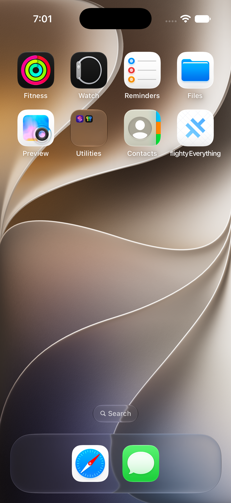

# 图 4：深色流程误截到系统桌面

## 来源

原文件为 `release/run29-e026fa5/qa/iphone-dark.png`，目录版本 `e026fa5`，1206 × 2622 像素。虽名为 `iphone-dark.png`，实际内容是系统桌面。

## 画面和异常

可以看到系统壁纸、Fitness、Watch、Reminders、Files，以及旧名称 `flightyEverything` 和旧应用图标。没有应用内部的地图、行程面板或深色 Dock。

同目录 [深色布局 JSON](evidence/e026fa5-layout-dark.json) 与最终截图内容不一致，不能据此认定深色界面通过。可能涉及应用退出、启动状态或截图时机，单张图不能确认根因，不能宣称已修复。

此图仅为历史异常证据，不是新黑底 FLY 图标或新版应用的运行效果。本次未重新启动验证。
